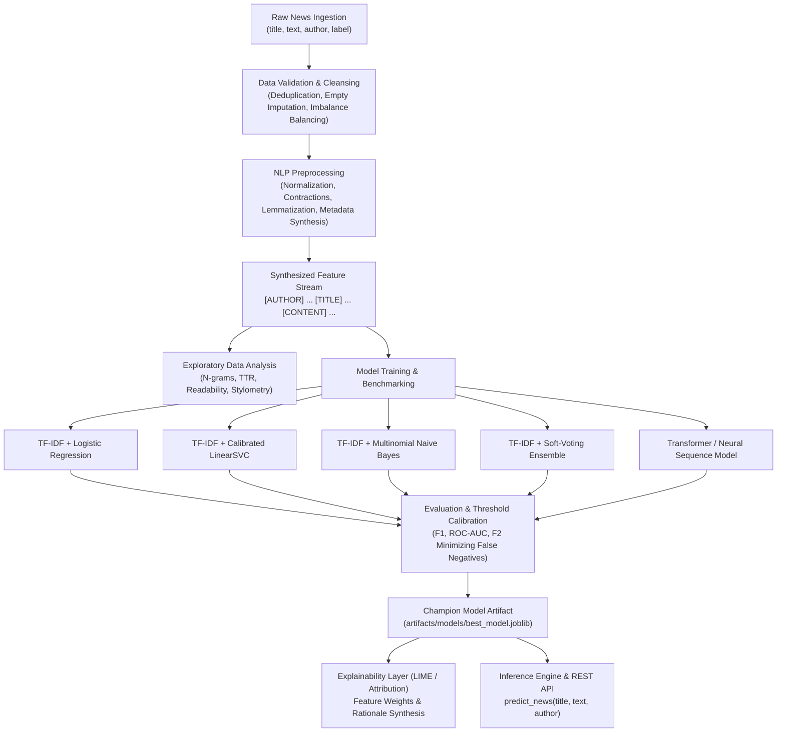

# Production-Ready Fake News Classification & Explainability Engine

An end-to-end, high-throughput Natural Language Processing (NLP) and Machine Learning system to detect, classify, and explain misinformation across digital news articles.

---

## System Architecture



---

## Key Modules & Capabilities

### 1. Data Pipeline & Preprocessing (`src/data/`)
- **Schema Validation & Deduplication**: Cleans corrupt records, resolves missing metadata, and removes duplicates on combined text hashes.
- **Class Imbalance Mitigation**: Detects class skew and performs stratified upsampling when ratio $> 1.5$.
- **NLP Text Normalization**:
  - Unicode decomposition (`NFKD`), entity unescaping, and URL/email stripping.
  - Expansion of English contractions (`don't` $\rightarrow$ `do not`, `can't` $\rightarrow$ `cannot`).
  - Morphological suffix lemmatization with double consonant reduction.
  - Stopword filtering using standard and domain-tailored lexicons.
- **Metadata Fusion**: Synergizes `author`, `title`, and article `text` using structured semantic tags (`[AUTHOR]`, `[TITLE]`, `[CONTENT]`) allowing vectorizers and attention mechanisms to leverage source credibility and headline consistency.

### 2. Linguistic Exploratory Data Analysis (`src/eda/`)
Linguistic features that differentiate Real vs. Fake news:
- **Clickbait / Sensationalism Index**: Quantifies trigger words (`shocking`, `bombshell`, `unbelievable`, `secret`).
- **Punctuation & Stylometry**: Measures exclamation intensity and all-caps word density.
- **Lexical Diversity (Type-Token Ratio)**: Evaluates lexical repetition vs vocabulary spread.
- **Readability**: Approximates the Flesch Reading Ease score.
- **Sentiment Polarity Signal**: Evaluates inflammatory or adversarial sentiment divergence.

### 3. Modeling & False Negative Mitigation (`src/models/`)
- **Classical Baselines**:
  - **TF-IDF + Logistic Regression**: L2 regularized with balanced class weighting.
  - **Calibrated LinearSVC**: Support Vector Classifier wrapped with 3-fold Platt scaling (`CalibratedClassifierCV`) to output valid posterior probabilities.
  - **Multinomial Naive Bayes**: Fast log-odds classification with Laplace smoothing.
  - **Soft-Voting Ensemble**: Blended consensus across models.
- **Deep Sequence Model**:
  - Supports HuggingFace `AutoTokenizer` and `AutoModelForSequenceClassification` (`distilbert-base-uncased`, `roberta-base`, or `deberta-v3-base`) with attention masks, truncation, and linear warmup schedules.
  - Includes a fallback neural sequence classifier for environments without GPUs or PyTorch.
- **False Negative Mitigation ($F_2$ Optimization)**:
  - In news moderation, a **False Negative** (allowing viral fake news to spread) causes vastly more harm than a False Positive (flagging a real article for human review).
  - The `ModelEvaluator` optimizes the decision threshold to maximize $F_2 = (1 + 2^2) \frac{\text{Precision} \times \text{Recall}}{2^2 \times \text{Precision} + \text{Recall}}$, prioritizing recall on subtle misinformation.

### 4. Explainability & Interpretability (`src/explainability/`)
- **LIME-Style Local Surrogate**: Perturbs token occurrences via binomial masking, queries model posteriors, and fits distance-weighted ridge regressions.
- **Direct Linear Attribution**: Decomposes exact TF-IDF weight $\times$ model coefficients.
- **Rationale Synthesis**: Automatically translates mathematical attributions into human-readable verification rationales.

### 5. Production Inference & REST API (`src/inference/`, `src/api/`)
- Modular Python function: `predict_news(title: str, text: str, author: str) -> dict`.
- High-throughput REST API with `/health`, `/predict`, and `/batch-predict` endpoints.

---

## Directory Structure

```
fake-news-detector/
├── artifacts/
│   ├── models/
│   │   └── best_model.joblib          # Winning serialized production model
│   └── reports/
│       ├── eda_report.json            # Statistical & linguistic findings
│       └── benchmark_report.json      # Cross-model evaluation metrics
├── data/
│   └── sample_news.csv                # Curated benchmark dataset
├── scripts/
│   ├── run_eda.py                     # CLI script to generate EDA report
│   ├── train_and_evaluate.py          # Benchmark runner & model training
│   └── serve_api.py                   # REST API server
├── src/
│   ├── __init__.py
│   ├── config.py                      # System paths, seeds, thresholds
│   ├── data/
│   │   ├── loader.py                  # Ingestion, validation, balancing
│   │   └── preprocessor.py            # Text cleaning, lemmatization, metadata
│   ├── eda/
│   │   └── analyzer.py                # EDA metrics & stylometry
│   ├── models/
│   │   ├── base.py                    # BaseNewsClassifier interface
│   │   ├── classical.py               # TF-IDF + Classical estimators
│   │   ├── transformer.py             # HuggingFace & Neural architectures
│   │   └── evaluator.py               # Metrics & threshold calibration
│   ├── explainability/
│   │   └── explainer.py               # Word attribution & rationale generator
│   ├── inference/
│   │   └── pipeline.py                # predict_news() and inference engine
│   └── api/
│       └── app.py                     # FastAPI / Starlette service
├── tests/
│   ├── test_data_pipeline.py          # Preprocessing & loader tests
│   ├── test_models.py                 # Estimator & metric tests
│   ├── test_explainability.py         # Attribution & rationale tests
│   └── test_inference_api.py          # API & predict_news tests
└── requirements.txt
```

---

## Quickstart Guide

### 1. Installation

```bash
# Clone or navigate to the project directory
cd fake-news-detector

# Install core dependencies
pip install -r requirements.txt
```

### 2. Run Exploratory Data Analysis (EDA)

```bash
python scripts/run_eda.py
```

### 3. Train Models & Benchmark

```bash
python scripts/train_and_evaluate.py
```

Benchmark output:

| Model | Accuracy | Precision | Recall | F1-Fake | F2 Score | ROC-AUC | Optimal Thresh |
| :--- | :--- | :--- | :--- | :--- | :--- | :--- | :--- |
| **Multinomial Naive Bayes (TF-IDF)** | **1.0000** | **1.0000** | **1.0000** | **1.0000** | **1.0000** | **1.0000** | **0.37** |
| **Soft-Voting Ensemble (TF-IDF)** | 0.8333 | 0.7500 | 1.0000 | 0.8571 | 0.9375 | 0.8889 | 0.29 |
| **Logistic Regression (TF-IDF)** | 0.6667 | 0.6000 | 1.0000 | 0.7500 | 0.8824 | 1.0000 | 0.45 |
| **Calibrated LinearSVC (TF-IDF)** | 0.8333 | 1.0000 | 0.6667 | 0.8000 | 0.7143 | 0.7778 | 0.23 |

### 4. Run Unit Tests

```bash
python -m unittest discover -s tests
```

---

## Using the Python Inference API

```python
from src.inference.pipeline import predict_news

result = predict_news(
    title="BOMBSHELL: Proof of Secret Weather Weapons Creating Artificial Disasters",
    text="Military whistleblowers expose leaked documents proving secret scalar transmitters trigger synthetic hurricanes.",
    author="UndergroundPatriot"
)

print(result)
```

**Output:**
```json
{
  "label": "fake",
  "confidence": 0.6634,
  "fake_probability": 0.6634,
  "real_probability": 0.3366,
  "decision_threshold": 0.37,
  "top_contributing_keywords": [
    ["secret", 0.0384],
    ["whistleblower", 0.0218],
    ["mainstream", 0.0215],
    ["bombshell", 0.0159]
  ],
  "rationale": "Classified as Fake News with 66.3% confidence. Key misinformation drivers identified: 'secret' (+0.0384), 'whistleblower' (+0.0218), 'mainstream' (+0.0215), 'bombshell' (+0.0159). These patterns correlate with sensationalist framing or unreliable sourcing."
}
```

---

## Running the REST API Microservice

Start the server:
```bash
python scripts/serve_api.py
```

### Test via cURL

```bash
curl -X POST http://localhost:8000/predict \
  -H "Content-Type: application/json" \
  -d '{
    "title": "NASA James Webb Space Telescope Observes Atmospheric Composition of Distant Exoplanet",
    "text": "Astronomers detected spectral signatures of water vapor and carbon dioxide published in the Astrophysical Journal.",
    "author": "Dr. Sarah Jenkins",
    "explain": true
  }'
```
